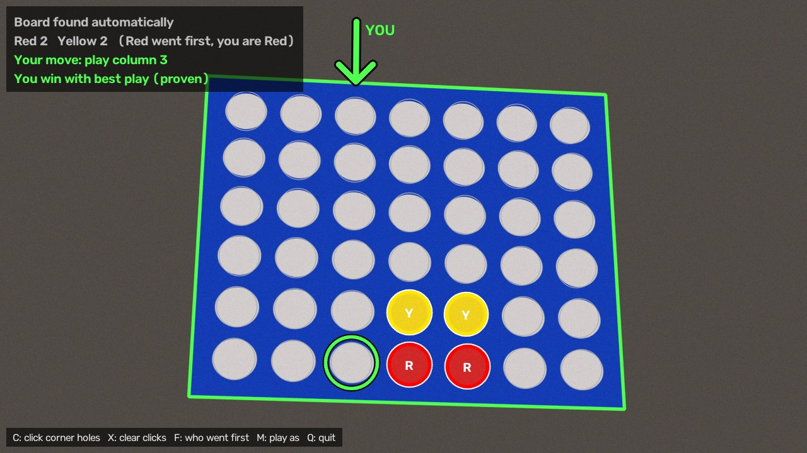

# Vision Connect Four

Point a webcam at a real Connect Four board and get live move advice. The app
reads the board from video, labels every piece it sees, and draws an arrow over
the column to play next. When the outcome can be proven (win, draw or loss with
perfect play), it says so. It can also read its advice aloud into an earbud.



## Features

- **Reads a real board from a webcam.** Finds the 6 × 7 grid of holes, even at
  an angle, and labels each hole red, yellow or empty on the live video.
- **Suggests the best move.** An arrow points at the column, and a ring marks the
  hole the piece will land in.
- **Says when the result is proven.** Later in the game, the solver proves whether
  the position is a win, draw or loss with perfect play. Early in the game it
  shows a best guess, which keeps improving while the player thinks. If it finds
  a better move, the suggestion updates.
- **Plays your side.** With `--me`, you get a "YOU" arrow on your turn and a
  purple "THEM" arrow showing the opponent's best move on theirs.
- **Gives losing players the best chance.** When every move loses against
  perfect play, it picks the move that leaves the opponent the fewest winning
  replies, so a human is most likely to slip up.
- **Mistake alerts.** Flags any move that throws away a proven win or draw, for
  example "Yellow blundered! You can now force a win."
- **Audio for earbuds.** With `--audio`, it speaks your column, whether the
  position is proven, mistake alerts and the result.
- **Game logs and replay.** Saves every game move by move. Step back through a
  finished game to see what the best move was at each point.

## What you need

- **Python 3.10 or newer.** Developed on Python 3.14.
- **A webcam.** A laptop camera works if it can see the whole board.
- **A standard Connect Four board:** blue frame, red and yellow pieces. See-through
  boards work, and so does a blue stand.
- **macOS for spoken audio.** It uses the built-in `say` command. Everything
  else should also work on Linux and Windows, where `--audio` prints its
  announcements to the terminal instead.

## Install

```sh
git clone https://github.com/PittCaleb/vision-connect-four.git
cd vision-connect-four
python3 -m venv .venv
source .venv/bin/activate            # Windows: .venv\Scripts\activate
pip install -r requirements.txt
```

Try it without a camera first. This shows a rendered board:

```sh
python -m connect4 --demo 4455
```

## Set up the board and camera

1. **Face the board toward the camera.** Straight-on is best. Up to about 20–25°
   off is fine; much more and the holes become thin slivers the app can't read.
2. **Get the whole board in the frame** with a little space around it.
3. **Keep the camera still** during the game.
4. **Light the board evenly.** See "Lighting" below. It makes the biggest
   difference to how reliably pieces are read.

### Lighting

The app tells red from yellow by color, so the light on the board matters more
than anything else.

**Works well:**
- Daylight from a window to the side of the board, or ordinary room lighting.
- Evening light (tested). Yellow pieces look paler in warm or fading light, and
  the app allows for that.
- A bright window or wall *behind* the board. The app ignores whatever shows
  through empty holes.

**Causes problems:**

| Lighting | What goes wrong | What to do |
| --- | --- | --- |
| Dim room | Colors fade toward gray, so pieces read as empty, or the board isn't found | Turn on a lamp near the board |
| Glare or direct sun on the board | Shiny spots look white, so a piece can read as empty | Move the light or tilt the board slightly |
| Strongly colored light (warm bulbs, sunset, colored LEDs) | Yellow drifts toward orange, red toward pink | Add a neutral light, or retune the colors (see `AGENTS.md`) |
| Shadow over part of the board | Pieces in the shadow, often the bottom rows, read as empty | Light the board from the front or side, not from directly above |
| Light changing during a game | A setup that worked can start missing pieces | Keep the lighting steady, for example a lamp rather than fading daylight |

**Quick check before a game:** drop one red and one yellow piece in. Both should
be labeled R and Y on screen, and stay that way without flickering. If one
shows as empty or flickers, fix the lighting before playing.

## Play

```sh
python -m connect4 --me red          # you play Red; use --me yellow for Yellow
```

Always use `python -m connect4`, with `-m`. Running `python connect4` fails with
"attempted relative import with no known parent package".

On the first run, macOS asks for camera access for your terminal (or PyCharm).
Allow it and start the app again. You can change this later under
**System Settings → Privacy & Security → Camera**.

**During a game:**

- **After each move, take your hand out of the frame.** The app updates once the
  board has held still for about a fifth of a second.
- **Early in the game, wait about 5 seconds.** The panel shows "Thinking..." until
  the first suggestion appears. It keeps thinking after that, and if it finds a
  better move, the arrow moves and the panel says "Changed from column N".
- **Proven results show straight away.** For example: "You win with best play
  (proven)".
- **If Yellow went first, press F.** Otherwise the app can't tell whose turn it is
  when both colors have the same number of pieces.
- **To start a new game, clear the board.**

**Colors on screen:**

| Color | Meaning |
| --- | --- |
| Green | Proven win for you (or for the player to move, without `--me`) |
| White | Proven draw |
| Orange | Proven loss |
| Light blue | Best guess, not proven yet |
| Purple | The opponent's best move (with `--me`) |

### Audio for an earbud

```sh
python -m connect4 --me red --audio
```

On your turn, the app speaks the column and the result once it's proven, for
example "Column 4. You can force a win." If more thinking changes the move, it
says "Change: column 5." It also speaks mistake alerts and the final result. With
`--me`, it only speaks on your turn. Without `--me`, it names the player, for
example "Yellow: column 3."

## Command-line options

| Option | Default | What it does |
| --- | --- | --- |
| `--me {red,yellow}` | none | The color you play. Your moves get a YOU arrow, and the opponent's best move is shown with a purple THEM arrow. Colors and audio are from your point of view. |
| `--first {red,yellow}` | `red` | Who moved first. Only used when both colors have the same number of pieces. Press F to change it while running. |
| `--audio` | off | Speak suggestions, proven results, mistake alerts and the winner aloud (macOS `say`). |
| `--first-suggestion SECONDS` | `5` | How long to think before showing a best guess. Proven results show at once. Thinking continues afterwards. |
| `--think SECONDS` | unlimited | Stop thinking about a position after this long. By default it keeps improving until the board changes. |
| `--camera N` | `0` | Which webcam to use. Try `1` or `2` if `0` is the wrong one. |
| `--image PATH` | | Read a still photo instead of the webcam. |
| `--demo [MOVES]` | | Use a rendered board instead of the webcam. `MOVES` is a string of column numbers (1–7) in the order played, for example `4453`. |
| `--replay LOG` | | Step through a saved game log on a rendered board (see "Replaying a game"). |
| `--log-dir DIR` | `games` | Where game logs are saved. |
| `--no-log` | off | Don't save game logs. |
| `--calibration PATH` | `calibration.json` | Where hand-clicked corner holes are saved (see the C key). |

`--camera`, `--image`, `--demo` and `--replay` can't be combined.

## Keyboard controls

Press these while the app's window is focused:

| Key | Action |
| --- | --- |
| C | Locate the board by hand: click the centers of the 4 corner holes, in any order. Saved for next time. Press C again to cancel. |
| X | Forget the hand-clicked holes and go back to automatic detection. |
| F | Switch who went first. |
| M | Switch who you play as: nobody, Red, Yellow. |
| Q or Esc | Quit. |

## Game logs

Each game is saved as a JSON file in `games/`, named after the time of the first
move, for example `games/2026-11-06_14-32-05.json`. The file is updated after
every move, so nothing is lost if the app closes mid-game.

```json
{
  "started": "2026-11-06T14:32:05",
  "first_player": "Red",
  "start_position": null,
  "moves": "4453",
  "result": null,
  "note": null,
  "move_details": [
    {"number": 1, "player": "Red", "column": 4, "time": "2026-11-06T14:32:05",
     "best_play_before": "win", "best_play_after": "win", "alert": null}
  ]
}
```

- `moves` uses the same format as `--demo`, so `python -m connect4 --demo 4453`
  shows the final position again.
- `best_play_before` and `best_play_after` give the mover's result with perfect
  play: `win`, `draw`, `loss`, or `unknown` if it wasn't proven yet.
- `start_position` is set if the app started mid-game. It lists the rows top to
  bottom, with `R`, `Y` and `.` for empty.
- `note` explains if logging stopped early, for example because pieces were
  removed.

### Replaying a game

```sh
python -m connect4 --replay games/2026-11-06_14-32-05.json --me red
```

This shows the game on a rendered board, starting from the empty position.

| Key | Action |
| --- | --- |
| → or `.` | Next move |
| ← or `,` | Previous move |
| Home / End | Jump to the start or end (Fn + ← / → on a Mac laptop) |
| Q | Quit |

At each step, the panel shows who played which column and any mistake alert
recorded at that move. The arrow shows the best move from that position, using
the same live analysis as a real game. For example, step back to just before a
mistake to see what should have been played. Replays aren't logged as new games.

## Troubleshooting

| Problem | Fix |
| --- | --- |
| "attempted relative import with no known parent package" | Run `python -m connect4`, not `python connect4`. |
| "Couldn't open camera" | Allow camera access for your terminal in System Settings → Privacy & Security → Camera, then restart the app. |
| Wrong camera, or a black or placeholder image | Try `--camera 1` or `--camera 2`. |
| "Board not found" | Turn the board to face the camera, make sure the whole board is in view, and add light if the room is dim (see "Lighting"). If it still fails, press C and click the 4 corner holes. |
| A piece is misread, or flickers | See "Lighting": usually dim light, glare or a color cast. The color thresholds are in `VisionConfig` in `connect4/vision.py`; `AGENTS.md` explains how to retune them from a captured frame. |
| "That doesn't look like a real position" | The reading has a floating piece or impossible counts. Usually a hand or glare; it clears once the board is visible again. |
| Wrong player shown to move | If Yellow went first, press F or start with `--first yellow`. |

## How it works

1. **Find the board.** Mask the board's saturated blue, find the round holes
   inside it, and fit the 6 × 7 grid to them. That handles angles, a blue stand
   and see-through holes.
2. **Read the pieces.** Flatten the board to a square-on view and check the color
   at each hole.
3. **Wait for a steady reading.** A reading is only trusted after it holds for
   several frames, and only if it's a legal position (no floating pieces,
   sensible counts).
4. **Search for the best move.** A bitboard negamax solver with alpha-beta pruning
   searches deeper and deeper. It runs in a separate process, so the video stays
   smooth.
5. **Track the game.** Each new position is matched to the move that produced it,
   logged, and checked for mistakes.

| Module | Role |
| --- | --- |
| `connect4/app.py` | Main loop, window, keys and command-line options |
| `connect4/vision.py` | Board detection and piece colors |
| `connect4/board.py` | Board rules: whose turn, wins, legal positions |
| `connect4/solver.py` | Move search |
| `connect4/worker.py` | Runs the solver in a background process |
| `connect4/game.py` | Move tracking, mistake alerts and game logs |
| `connect4/replay.py` | Stepping through saved games |
| `connect4/speech.py` | Spoken announcements |
| `connect4/overlay.py` | Drawing on the video |
| `connect4/synthetic.py` | Rendered boards for tests and `--demo` |

## Limitations

- **Early-game suggestions are best guesses.** Connect Four is solved: the first
  player wins with perfect play by starting in the center. But this solver is
  pure Python, so in roughly the first third of the game it can't search to the
  end in real time. Its early suggestions are strong guesses, not guaranteed
  perfect, and a first player following them can still lose. Once the result is
  proven, the suggestion is exact.
- **The board must roughly face the camera,** within about 20–25°.
- **Spoken audio is macOS only.**

## Running the tests

```sh
pip install -r requirements.txt
python -m pytest                                         # about 1 minute
python -m pytest --cov=connect4 --cov-report=html        # coverage report in htmlcov/
```

The tests cover the solver (checked against brute force), board reading on
rendered and real photos, the game tracker, audio and the app logic. They don't
need a webcam.

## Contributing

- **AI agents and developers:** start with [`AGENTS.md`](AGENTS.md). It covers
  the architecture, conventions, how colors are calibrated, and known pitfalls.
- **Planned work:** see [`TODO.md`](TODO.md), including an optional C solver for
  perfect play from move 1.
- **Changes:** work on a branch and open a pull request into `main`.
